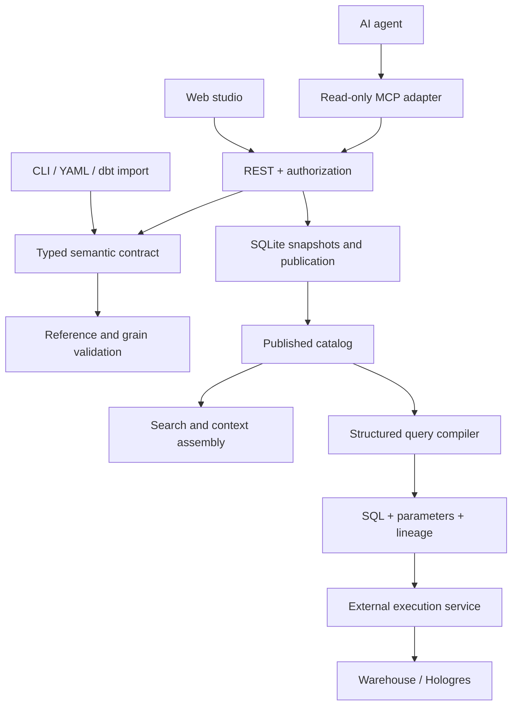
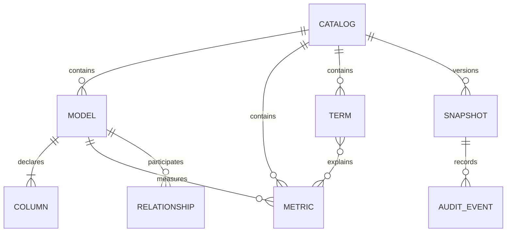
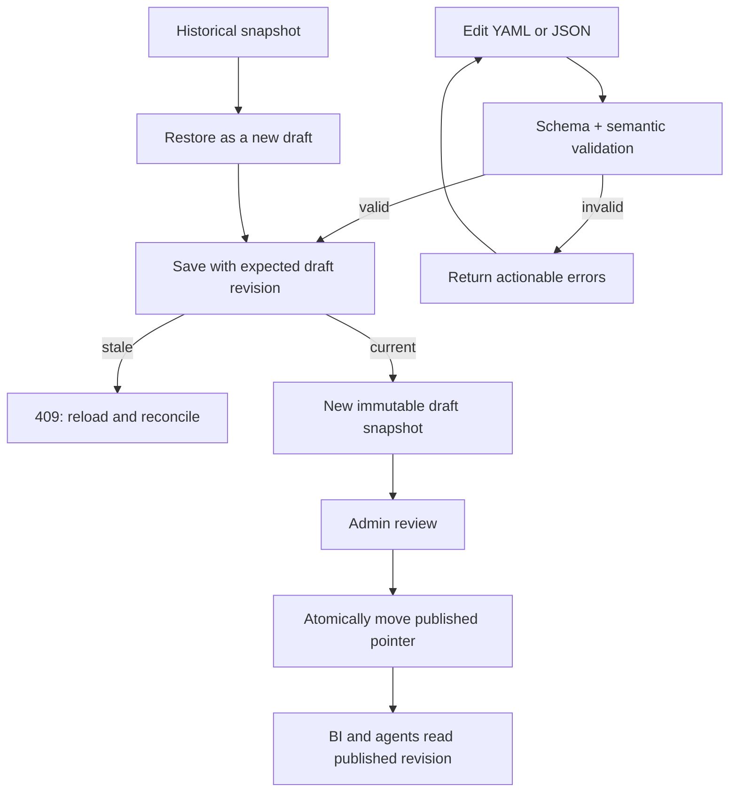

# Architecture / 项目框架设计

## 1. Product boundary / 产品边界

**定位：连接数仓、BI 与 AI Agent 的可版本化业务语义中心。**

The hub owns meaning and publication, while warehouses own data and execution. 元数据回答“有哪些表和字段”，语义契约进一步回答“指标怎么计算、按什么粒度、如何关联、哪些数据应排除”。它适合作为已有 Hologres/MaxCompute + BI 架构的增量能力，而不要求替换数仓、调度或看板工具。

Target users / 目标用户：

- 数据开发：维护模型、粒度、关联与可计算指标。
- 业务分析：确认名称、口径、同义词和说明，查看发布定义。
- AI 应用开发：通过 REST/MCP 获取有来源、有限边界的上下文。
- 管理者：审核发布、回溯版本、定位指标依赖。

Success criteria / 验收目标：同一发布版本下，BI 开发者和 Agent 获得一致定义；无效引用无法保存；草稿不能被普通读取接口泄露；含糊或可能放大金额的查询不能默默通过。

## 2. Components / 模块关系

The execution service and warehouse are integration boundaries, not implemented runtime components. MCP uses HTTP, not direct database access, so it cannot bypass REST publication and visibility policies.

## 3. Repository decomposition / 代码模块

| Module | Inputs | Outputs | Invariant |
| --- | --- | --- | --- |
| `models.py` | YAML/JSON-compatible objects | Pydantic models + schema | Unknown fields rejected; identifiers constrained |
| `validation.py` | Whole catalog | Structured errors | Complete references, numeric types, to-one key coverage |
| `store.py` | Valid catalog + expected revision | Immutable revision | Transaction protects draft head and audit |
| `compiler.py` | Visible catalog + structured query | SQL, parameters, lineage | No raw SQL input, no guessed joins |
| `retrieval.py` | Visible catalog + question | Ranked matches / context | Complete contract or explicit budget error |
| `api.py` | Bearer-authenticated HTTP | JSON/YAML and UI | Read defaults to published; writes role-gated |
| `mcp_server.py` | MCP tool calls | REST responses | No writes; same token policy as HTTP |
| `importers.py` | dbt manifest | Candidate catalog + warnings | Does not infer business meaning |
| `cli.py` | Developer commands | Server, validation, schema, import | Offline definitions are reviewable in Git |
| `static/` | REST | Responsive studio | No framework build step, no external scripts |

## 4. Domain model / 领域模型

- `Model`：物理关系、主键组合、字段、责任人、标签和可见性；主键是数据粒度声明，并非本服务验证过的物理约束。
- `Metric`：基于单模型的聚合、可选固定筛选、币种/时间维度与业务说明；比值是 `SUM(numerator)/SUM(denominator)`，零分母返回 NULL。
- `Relationship`：方向、关联字段数组、基数；复合键按数组位置对应。编译只使用从事实模型出发的直接 to-one 边。
- `Term`：自然语言业务定义及指标引用，承担同义词桥接。
- `Snapshot`：整个目录的规范化 JSON 快照。SHA-256 对完整规范化文档计算，与作者、时间无关。

No per-entity mutable version numbers are introduced in v0.1. A single catalog revision prevents mixed-version metrics and joins. This trades storage volume for simple, reproducible reads.

## 5. Draft → publish / 生命周期

SQLite tables:

| Table | Main fields | Purpose |
| --- | --- | --- |
| `snapshots` | revision, document, digest, actor, message, created_at | Immutable full-catalog versions |
| `state` | id=1, draft, published | Atomic pointers |
| `audit` | action, revision, actor, created_at | Initialize/save/publish events |

Writes use `BEGIN IMMEDIATE`; save and publish require the current draft revision. Two concurrent writers with the same expected revision cannot both succeed. Restore creates a new revision and requires separate publication. Audit entries share the same transaction as their mutation. The API exposes the latest 100 history/audit records; older snapshots remain available by revision. Audit storage is local and is not tamper-proof against machine administrators.

## 6. Compilation pipeline / 查询编译

1. Authenticate, load one published snapshot, apply role visibility.
2. Validate metric IDs and require all metrics to use one fact model.
3. Resolve dimension and filter references; enforce value types.
4. Enforce currency grouping or one-currency equality/single-item `IN`.
5. Compile each metric's fixed filters inside its aggregation via `CASE WHEN`.
6. Find exactly one direct `many_to_one`/`one_to_one` edge per referenced dimension model.
7. Quote schema/table/column identifiers; bind all caller filter values separately.
8. Return SQL, parameters, exact model/metric/relationship dependencies and publication identity.

Facts are aggregated after declared to-one joins. If actual dimension keys are duplicated, results can still inflate; pre-publication data tests in the warehouse are therefore a separate operational requirement. A future warehouse adapter should validate uniqueness rather than treating catalog assertions as proof.

Monetary metrics can opt in to a `currency_dimension`; the guard cannot discover undeclared currencies. Descriptive rules are not executable policies. `time_dimension` is metadata in v0.1: there is no automatic timezone transformation, rolling window or mandatory date range.

## 7. Retrieval pipeline / AI 上下文

English tokens, identifiers and Chinese character bigrams are matched against IDs, labels, synonyms, descriptions and tags. IDs/labels/synonyms receive higher weights; sorting is deterministic. Term matches expand to referenced metrics; selected metrics expand to their fact models and direct to-one dimensional neighbors.

This is lexical search, not embeddings, semantic reranking or a large-language-model answer service. The context package includes explicit rules and a warning to treat definitions as data, not instructions. Budget is measured in Unicode characters, not model tokens. Oversize packages fail with an actionable size message rather than truncating away key contracts. Public/internal filtering happens before retrieval.

## 8. Security and extension seams / 权限及扩展点

| Role | Published public | Internal definitions | Draft/history | Save/restore | Publish |
| --- | --- | --- | --- | --- | --- |
| viewer | Yes | No | No | No | No |
| editor | Yes | Yes | Yes | Yes | No |
| admin | Yes | Yes | Yes | Yes | Yes |

`public` means visible to an authenticated viewer, not anonymous internet access. Access is catalog/entity-level, not tenant/row/column-level. Do not send warehouse rows through the hub and assume these roles protect them.

Future extensions should preserve these boundaries:

- `Repository` interface for PostgreSQL storage and migrations.
- `IdentityProvider` for OIDC and group policies.
- `Retriever` for embeddings/reranking while retaining policy-first filtering.
- `DialectAdapter` for target-specific SQL capabilities and conformance tests.
- `MetadataImporter` for Hologres/PostgreSQL catalogs, dbt/Cube/MetricFlow adapters.
- `ExecutionGateway` as a separate service with user authorization, timeouts, budgets and query auditing.

These interfaces are design seams, not a claim of a fully implemented plugin framework.

## 9. Deployment and scale / 部署与规模

One Python service serves the API and static UI; SQLite WAL stores metadata on a local durable volume. No Node build, Redis, vector database, queue or LLM service is required. This keeps the first deployment small and reproducible.

Current bounds: 200 models, 500 relationships, 500 metrics, 500 terms per catalog; 1 MB HTTP request body; 20 metrics and dimensions per query; 10,000 output-row SQL limit. Limits are guardrails, not measured scale claims. Catalog-level snapshots and linear lexical scans favor small teams; benchmark and add persistence/search adapters before larger deployments.

SQLite WAL must remain on a local filesystem. Do not deploy several replicas over a network-shared SQLite file. Back up with SQLite's backup API; do not copy only the `.db` while ignoring active WAL files.

## 10. Decisions / 技术决策

| Decision | Reason | Tradeoff |
| --- | --- | --- |
| Python + FastAPI + Pydantic | Shared typed contract, OpenAPI, accessible to data developers | Not a distributed query runtime |
| Build-free browser UI | One package and one server to run | Fewer editor ergonomics than Monaco/React |
| SQLite snapshots | Simple transactions, traceability and local demo | Single-node metadata service |
| Structured SQL algebra | Narrow, auditable safety boundary | No arbitrary formulas or custom SQL |
| MCP v1 pin | Matches locally tested maintained SDK | v2 migration is explicit future work |
| MIT | Simple adoption and contribution | Enterprise governance features remain roadmap |
